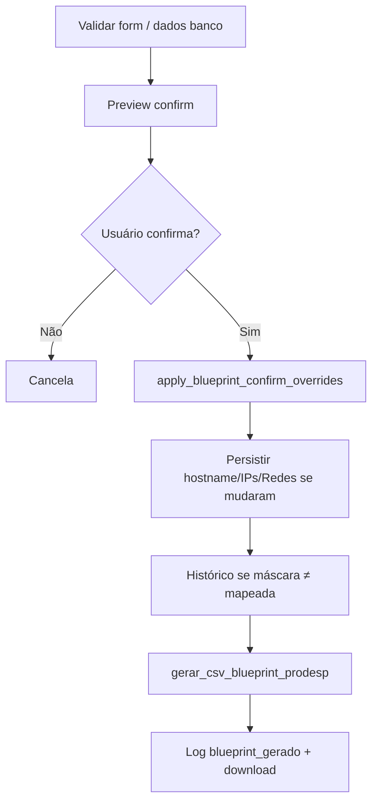

# Blueprint CSV — PRODESP

Guia de geração do CSV SD-WAN, confirmação pré-geração, Device Blueprint dinâmico e manutenção.

**Fontes de verdade**

| Área | Módulo |
|------|--------|
| CSV / máscaras / motor Device BP | `prodesp/prodesp/blueprint/prodesp_csv_generator.py` |
| **Catálogo acrônimo → template/regras** | Tabelas `prodesp_blueprint_secretaria` (+ alias); UI Admin **Secretarias Blueprint**. Código: `blueprint_catalog.py` + `blueprint_secretaria_repo.py`. Seed: `sql/021_blueprint_secretaria_catalog.sql` |
| Rotas form + API | `prodesp/prodesp/blueprint/prodesp_routes.py` |
| Modal / cascade LAN | `prodesp/static/js/prodesp_blueprint_confirm.js` |
| Partial LAN SEC/TER/QUA | `templates/partials/prodesp_lan_extra_unidades.html` |
| Modal UI | `templates/partials/prodesp_blueprint_confirm_modal.html` |
| Regras de link (VIVO, RC, unicidade) | [`regras-de-negocio.md`](regras-de-negocio.md) |

## Páginas que usam o mesmo fluxo

| Página | Como gera | Confirmação |
|--------|-----------|-------------|
| `/prodesp/atendimentos` | `POST /api/gerar_blueprint_prodesp/<id_vgr>` via `ProdespBlueprintConfirm.generateWithConfirm` | Modal compartilhado |
| `/prodesp/dashboard_atendimentos` | Idem (`script_atendimentos_prodesp.js` + partials) | Idem |
| `/prodesp/criar_blueprint` | Form `POST /gerar_blueprint_prodesp` após `previewThenConfirm` | Overrides voltam ao form; CSV usa dados persistidos no POST |

Cache-bust: JS `?v=bp-confirm-*` nos templates; CSS `modals.css?v=bp-confirm-*` em `templates/snippets/prodesp_stylesheets.html`. Após mudar JS/CSS, subir a versão e hard refresh.

## Fluxo (resumo)



1. **Prévia:** `GET|POST /api/preview_blueprint_prodesp/<id_vgr>` ou 1º passo da API de gerar sem `confirm=true`.
2. **Payload `confirm`:** hostname, LANs (IP + máscara), Redes LAN (1 calculada + SEC/TER/QUA), gateways MPLS/STATIC (RO), Device Blueprint + motivo, `mask_options`, `lan_count`.
3. **Overrides JSON (API):** `hostname`, `ip_lan_01`, `mv_ip_lan_*`, `mv_rede_lan_*`, `mask_lan` / `mask_lan_sec` / …
4. **Form criar Blueprint:** modal aplica overrides nos inputs (CIDR com máscara só se o IP estiver preenchido) e reenvia o form.

## Device Blueprint dinâmico

Funções: `resolve_device_blueprint_detail`, `_apply_lan_count_to_device_blueprint`, `count_lan_ips_filled`.

1. Acrônimo → regra no **catálogo** (`resolve_rule` / alias); miss ou inativo → `BP_OES_{modelo}` + layout **REDE_LAN** (regra rede nova, IP−1).
2. Modelo FortiGate (`40F`/`60F`/…) a partir de `modelo_equipamentos` ou serial.
3. Sufixo `REDE_LAN_*` conforme **níveis LAN** (LAN 1 + SEC + TER + QUA), se `aplica_sufixo_lan_dinamico=1` no catálogo.
   - **Opt-out** (ex. POUPATEMPO): flag do cadastro — template fixo.

| Níveis preenchidos | Sufixo |
|--------------------|--------|
| 1 (só LAN 1) | `_1` |
| 2 (+ SEC) | `_1_2` |
| 3 (+ TER) | `_1_2_3` |
| 4 (+ QUA) | `_1_2_3_4` |

Exemplos: `…_REDE_LAN_1` → `…_REDE_LAN_1_2_3`; TJSP `…_REDE_LAN_1_VOZ_WIFI` → `…_1_2_3_VOZ_WIFI`.

Templates base e regras de DHCP/rede (exemplos do seed): ver [`regras-de-negocio.md`](regras-de-negocio.md) §9 e **Admin → Secretarias Blueprint** em produção.

O motivo exibido no modal vem de `device_blueprint_motivo` (acrônimo + contagem LAN).

## Anti duplo-clique / mensagens MySQL

- JS global `prodesp_submit_guard.js` (`ProdespSubmitGuard`) no `base_prodesp.html`: forms/botões com `data-prodesp-submit-guard`.
- Página Criar Blueprint: form com guard; modal confirmar também.
- Erros MySQL 1062: `message_from_mysql_exception` interpreta `Duplicate entry` (serial/MAC/ID VGR) em vez da mensagem genérica de conflito.
- INSERT de equipamento no Blueprint: re-leitura + tratamento de race (duplo POST).

## Modal de confirmação (UX)

Cada nível é um **bloco** (LAN 1 / SEC / TER / QUA) com **IP + Máscara + Rede** na mesma linha. Evita misturar Rede de um nível com IP de outro.

## LAN SEC → TER → QUA (UI)

- Campos com `data-lan-tier` / `data-lan-role` no partial `prodesp_lan_extra_unidades.html`.
- `bindLanCascade` (ao carregar a página): TER só se SEC preenchido (IP ou Rede); QUA só se SEC **e** TER.
- Limpar nível superior zera os inferiores desabilitados.
- Vale em atendimento, dashboard e criar Blueprint (mesmo JS).

## Máscaras na confirmação

Opções: `BLUEPRINT_MASK_OPTIONS` — **todas** as máscaras IPv4 `/0`–`/32` (labels `255.255.255.0 - /24`, etc.), geradas via `cidr_to_mask`.

| Caso | Comportamento |
|------|----------------|
| IP com CIDR | Máscara mapeada do CIDR; usuário pode trocar → CIDR atualizado |
| Só Rede LAN (sem IP) | Modal ainda mostra seletor (`allow_mask_without_ip`); CSV emite `MV_MASK_LAN_*` via `_blueprint_mask_lan_*` |
| Rede LAN 1 | Calculada (IP LAN − 1 ou regra **antiga**/`.0` do catálogo, ex. SEDS no seed); **não editável** no modal |
| Rede SEC/TER/QUA | Editáveis; persistem em `mv_rede_lan_*_unidades` |

Histórico (`registrar_log` em `unidades`): quando a máscara confirmada ≠ mapeada pelo CIDR, ou máscara sem IP — campo tipo `Máscara LAN SEC (blueprint)`.

**Nuance form vs API:** no criar Blueprint (POST form), a máscara só é reescrita no input se houver IP. Máscara **sem** IP + emissão `MV_MASK_*` depende do fluxo API (`confirm` + `overrides`), usado em atendimentos/dashboard.

## APIs

| Método | Rota | Função |
|--------|------|--------|
| GET/POST | `/api/preview_blueprint_prodesp/<id_vgr>` | Só prévia (`confirm` JSON); body opcional `overrides` |
| POST | `/api/gerar_blueprint_prodesp/<id_vgr>` | Sem `confirm=true` → `{ needs_confirm, confirm }`; com `confirm=true` → gera CSV |
| POST | `/gerar_blueprint_prodesp` | Form: salva unidade/links + gera (após modal no browser) |
| GET | `/download/blueprint/<filename>` | Download do CSV |

Auth: `@login_required` + gate de projeto. Validação server-side: `validar_dados_blueprint`, unicidade, limites.

## Manutenção

### Incluir ou alterar secretaria / Device Blueprint

**Sem deploy de código** (ambiente com migration 021 aplicada):

1. Abrir **Admin → Secretarias Blueprint** (somente `admin_user=1`).
2. Criar/editar: acrônimo canônico, aliases, template Device Blueprint, layout (`rede_lan` / `legado`), regra rede (`nova` −1 / `antiga` .0), sufixo LAN dinâmico, octetos DHCP LAN, flags DHCP server / omit legado.
3. Geração de CSV passa a usar a regra (cache de processo ≤60s; workers isolados atualizam no TTL).
4. Opcional: smoke em `/prodesp/criar_blueprint` com o acrônimo.

**Greenfield / reseed:** `prodesp/sql/021_blueprint_secretaria_catalog.sql` (CREATE + seed do catálogo inicial). Seed embutido em `blueprint_catalog.BUILTIN_SEED_RULES` espelha o SQL para testes.

Tabela ausente → API admin retorna 503; geração sem regra no catálogo usa `BP_OES` + layout **REDE_LAN**.

### Alterar opções de máscara do modal

`BLUEPRINT_MASK_OPTIONS` é gerado automaticamente (`/0`–`/32`) em `prodesp_csv_generator.py`. O form criar Blueprint converte máscara pontilhada → CIDR via `dottedMaskToCidr` (sem mapa fixo).

### Cascata LAN

Só UI (`bindLanCascade`). Persistência/CSV não impõem a ordem; se precisar regra server-side, adicionar em validação de unidade/Blueprint.

### Coluna CSV nova (LAN extra / MV)

1. Migration `sql/` + `db_field_limits` / specs `UNIDADES_*`.
2. `_lan_extra_row_pairs_csv_order` / builders em `prodesp_csv_generator.py`.
3. Partial + modal confirm se o campo entra na confirmação.
4. Smoke nas 3 páginas.

### Waitress / produção

Python não auto-reload: reiniciar o processo após mudanças em `prodesp_csv_generator.py` / rotas / catálogo. Mutação no Admin Secretarias invalida cache **no worker que gravou** (TTL ~60s nos demais). JS: bump `?v=` + hard refresh.

## Testes

```powershell
.\.venv_portal_pessoal\Scripts\python.exe -m unittest prodesp.prodesp.blueprint.test_blueprint_detran -v
.\.venv_portal_pessoal\Scripts\python.exe -m pytest prodesp/prodesp/blueprint/test_blueprint_catalog.py prodesp/prodesp/blueprint/test_blueprint_secretaria_flow.py -q
.\.venv_portal_pessoal\Scripts\python.exe -m pytest prodesp/prodesp/blueprint/test_blueprint_secretaria_http.py -q
.\.venv_portal_pessoal\Scripts\python.exe -m prodesp.prodesp.blueprint.smoke_blueprint_secretaria_catalog
.\.venv_portal_pessoal\Scripts\python.exe -m prodesp.prodesp.blueprint.test_blueprint_routes
```

Smoke manual: VGR com SEC/TER; confirmar máscara diferente do CIDR → histórico; TJSP com 2+ IPs LAN → Device BP com `_1_2…_VOZ_WIFI`; admin cria secretaria → CSV no acrônimo.

## Segurança (superfície)

| Risco | Mitigação |
|-------|-----------|
| Gerar CSV sem login | `@login_required` |
| Mutation via API | Projeto PRODESP; unicidade/obrigatórios no servidor |
| XSS no modal | Preferir `textContent` / valores escapados no JS de confirm |
| Path download | Pasta controlada do módulo |

Detalhe de rotas: [`apis-e-seguranca.md`](apis-e-seguranca.md).
